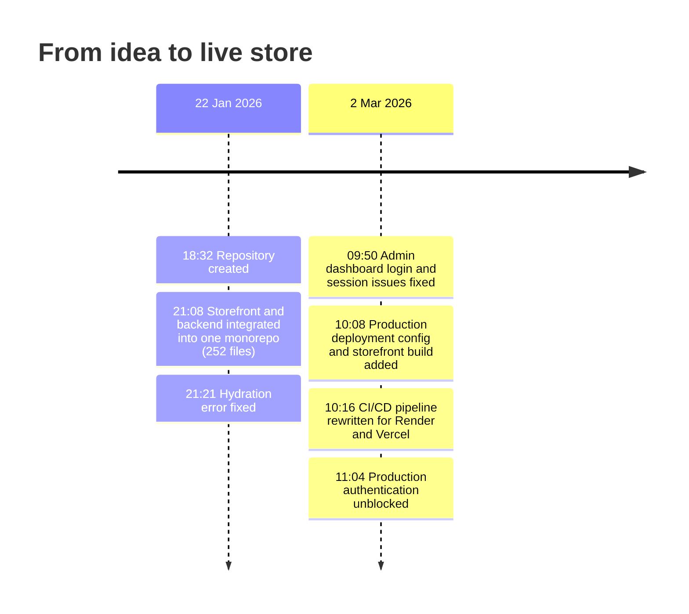
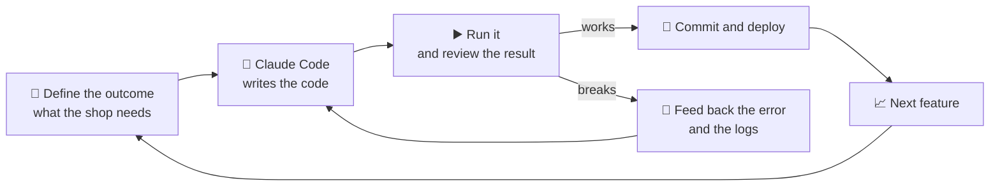
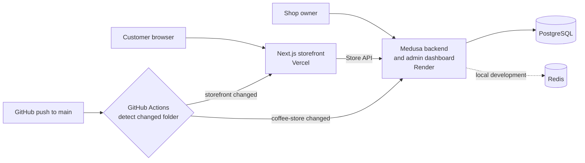

<div align="center">

# ☕ Bergkraft

### A direct-to-consumer specialty coffee store, built end to end and deployed live.


**A complete online shop for my own coffee brand: storefront, admin dashboard, catalogue, checkout and an automated deployment pipeline.**

> 🧑‍💻 **A personal project, built on my own.** I designed, built and deployed Bergkraft alone, working with Claude Code as my AI engineering partner.

[**🌐 Live store**](https://bergkraft.vercel.app) · [The idea](#-the-idea) · [Built with Claude Code](#-built-at-ai-speed-with-claude-code) · [What I built](#-what-i-built) · [Architecture](#-architecture) · [Quick start](#-quick-start) · [Technical details](#-technical-details)

</div>

---

## ☕ The idea

Bergkraft is a personal venture: a specialty coffee brand that sells directly to customers instead of through retailers. Selling direct means owning the whole experience, from the first impression on the homepage to the confirmation email after checkout, and keeping the margin and the customer relationship.

This repository is the technology behind that brand. It is a real, hosted web shop that was running for my coffee business, not a tutorial project.

**The brand story the store tells:** single-origin beans, ethically traded, small-batch roasting and expert curation, with a guide that helps customers find the brewing method that suits them.

---

## ⚡ Built at AI speed with Claude Code

This store was built by **one person working with an AI coding agent**. I acted as product owner and Claude Code acted as the engineering team: I decided what the shop needed and how it should feel, Claude Code wrote the code, and I ran it, reviewed it and steered it until it worked in production.

<div align="center">

| 🕒 | 🤖 | 🚢 |
|:---:|:---:|:---:|
| **Under 3 hours**<br/>from empty repository to a committed, working monorepo with storefront and backend | **Every deployment commit<br/>co-authored with Claude**<br/>visible in the git history | **74 minutes**<br/>to fix admin login, move to production hosting, build the CI/CD pipeline and unblock authentication |

</div>

### The timeline, straight from the git history



### How I work with Claude Code



1. **Define the outcome.** I describe what the customer should see and what the business needs, not how to code it.
2. **Let the agent build.** Claude Code writes the code, config and scripts across the whole stack.
3. **Run and review.** I run the stack, check the behaviour and read what was produced.
4. **Close the loop.** When something breaks, I feed the error and logs back, and we fix it together.
5. **Ship.** Changes go through the automated pipeline to production.

### Real problems solved with the AI in the loop

| Problem found | What it taught me | Fix |
|---|---|---|
| React **hydration error** on the storefront | The server and the browser rendered different content | Resolved by suppressing the mismatch warnings |
| **Admin dashboard login** and session failures | Admin access has to work in the hosted setup, not only on a laptop | Fixed the login and session handling |
| **Hosting move** from Railway to Render and Vercel | The backend and the storefront have different hosting needs | Rewrote the pipeline so each service deploys on its own |
| **Authentication blocked in production** | A Redis setting in the backend configuration was blocking logins on Render | Removed it from the production configuration |

### Why this matters

AI coding agents let one product person build and ship what used to need a small team. The skill that makes it work is not typing code. It is knowing **what to build, how to judge whether it works, and how to debug it when it does not**. That is the product work, and it is what this project shows.

---

## 🛍️ What I built

### For customers
- **Branded storefront:** homepage with a hero, brand promise, featured products, origin story, brew guide and newsletter sign-up
- **Product catalogue:** coffee beans, brewing equipment and merchandise, with variants for weight (250 g, 500 g, 1 kg) and grind (whole bean or ground)
- **Cart and checkout:** address entry, shipping method selection, discount codes, payment and order confirmation
- **Customer accounts:** registration, login, order history, saved addresses and profile management
- **Selling across markets:** North America in USD and Europe in EUR, with shipping to the UK, Germany, Denmark, Sweden, France, Spain and Italy

### For running the business
- **Admin dashboard:** manage products, prices, inventory, orders, customers and discounts without touching code
- **Shipping options:** standard and express delivery from a main warehouse
- **Sample catalogue on first start:** one command loads the regions, shipping, categories and products so the shop is usable immediately

### For shipping it reliably
- **One-command local setup** with Docker Compose
- **Automatic deployment:** a push to `main` deploys only the part that changed, the backend to Render and the storefront to Vercel

---

## 🧭 Why this project is a good example of how I work

| What it shows | How |
|---|---|
| **Product thinking** | Defined the customer journey, the catalogue structure, the markets, currencies and shipping options before building |
| **Choosing the right tools** | Used the open-source Medusa commerce engine for carts, orders and payments, and spent my effort on the brand experience and delivery |
| **AI-assisted engineering** | Built the whole system with Claude Code, acting as product owner: specifying, reviewing, and fixing problems until it ran in production |
| **Shipping, not just coding** | Containerised, automated the deployment pipeline and worked through real production issues (authentication, sessions, hosting changes) |
| **E-commerce fundamentals** | Catalogue and variants, pricing in several currencies, regions, shipping profiles, checkout, order management |

---

## 🏗️ Architecture



**Two services in one repository (a monorepo):**

| Folder | What it is |
|---|---|
| `coffee-store/` | The commerce backend (Medusa v2): products, carts, orders, customers, regions, shipping, plus the admin dashboard |
| `coffee-store-storefront/` | The customer-facing shop (Next.js 15, React 19, Tailwind CSS) |

---

## 🚀 Quick start

You need Docker with Docker Compose.

```bash
git clone https://github.com/dheerajsuvarna/coffee-store-project.git
cd coffee-store-project
docker compose up --build
```

Then open:

| Service | Address |
|---|---|
| Storefront | http://localhost:3000 |
| Backend API | http://localhost:9000 |
| Admin dashboard | http://localhost:9000/app |

**Load the sample catalogue and create an admin user** by starting the backend with `SEED_ON_START=true`. Set your own admin email and password with `ADMIN_EMAIL` and `ADMIN_PASSWORD`. To rebuild everything from scratch, run `./rebuild.sh`.

> ⚠️ The Docker Compose file uses development placeholder secrets. Set your own `JWT_SECRET`, `COOKIE_SECRET` and admin credentials before deploying anywhere public.

---

## 🔧 Technical details

### Stack

| Layer | Technology |
|---|---|
| Storefront | Next.js 15 (App Router, server components), React 19, TypeScript, Tailwind CSS |
| Commerce engine | Medusa v2 (Node.js 20) with the Medusa admin dashboard |
| Database | PostgreSQL 15 |
| Cache and events (local) | Redis 7 |
| Payments | Medusa payment providers, with Stripe components included in the checkout |
| Containers | Docker and Docker Compose, with health checks and automatic database migrations on start |
| CI/CD | GitHub Actions, path-based change detection |
| Hosting | Vercel (storefront), Render (backend) |

### Deployment pipeline

On every push to `main`, the workflow in `.github/workflows/deploy.yml` checks which folders changed:
- **Backend changed:** triggers the Render deploy hook
- **Storefront changed:** pulls the production environment from Vercel, builds the project, and deploys the prebuilt output

Unchanged services are skipped, which keeps deployments fast and avoids needless restarts.

### Seeded catalogue

| Category | Examples |
|---|---|
| Coffee Beans | Bergkraft Espresso Blend, Bergkraft House Blend |
| Equipment | Bergkraft Premium French Press |
| Merchandise | Bergkraft Canvas Tote Bag |

Prices are set in EUR and USD per region, with weight, grind, capacity and colour variants.

### Project layout

```
coffee-store-project/
├── coffee-store/                  Medusa backend
│   ├── medusa-config.ts           Backend configuration
│   ├── src/scripts/seed.ts        Regions, shipping, categories, products
│   ├── start.sh                   Migrations, optional seeding, server start
│   └── Dockerfile
├── coffee-store-storefront/       Next.js storefront
│   ├── src/app/                   Routes (home, products, cart, checkout, account)
│   ├── src/modules/               UI modules (home, checkout, account, layout)
│   ├── src/lib/data/              Backend data access
│   └── Dockerfile
├── docker-compose.yml             Local stack: database, Redis, backend, storefront
├── rebuild.sh                     Clean rebuild of the local stack
└── .github/workflows/deploy.yml   Automated deployment
```

### Configuration

Copy `coffee-store-storefront/.env.example` and set the backend URL, the publishable API key (created in the admin dashboard under Settings, then API Keys), the default region and the revalidation secret. Variables that start with `NEXT_PUBLIC_` are baked in at build time.

---

## 🗺️ Roadmap

- Live payment provider and transactional emails
- Subscriptions for recurring coffee deliveries
- Product reviews and a loyalty programme
- Analytics dashboard for conversion, average order value and repeat purchase rate
- Automated tests for the checkout flow

---

## 🙏 Acknowledgements

Built on the open-source [Medusa](https://medusajs.com) commerce engine and the Medusa Next.js starter storefront, with the Bergkraft brand, homepage, catalogue, deployment setup and fixes added on top. Developed with [Claude Code](https://claude.com/claude-code).

## 📄 License

The storefront starter is MIT licensed. See `coffee-store-storefront/LICENSE`.
